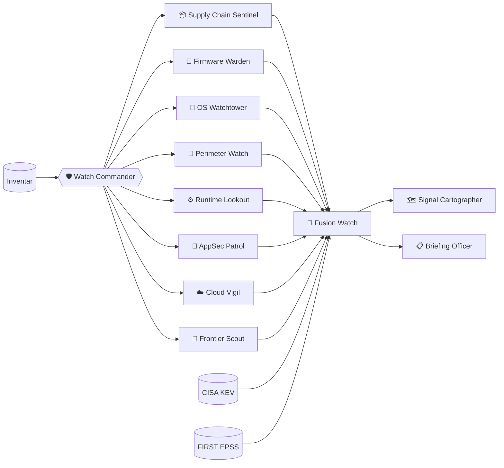

# CVE Watch (cve-agents): multi-agent CVE-overblik og ledelsesrapport

En vagtstyrke af agenter. Orkestratoren **Watch Commander** sender specialiserede *vagtposter* ud til hvert teknologidomæne. **Fusion Watch** samler fundene, afdækker hvordan sårbarheder forstærker hinanden og prioriterer. **Signal Cartographer** og **Briefing Officer** laver infographic og ledelsesrapport (PDF/HTML/Markdown).

Det hele kan styres fra en web-konsol. Her kan man chatte med orkestratoren, starte en indsamling, følge fremdriften pr. agent, se visualiseringen og downloade rapporten som PDF.

## Agenterne

| Codename | Funktion | Fil |
|---|---|---|
| 🛡️ **Watch Commander** | Orkestrator og vagtchef: planlægger, delegerer, følger fremdrift, svarer i chatten og modtager infrastrukturdata via MCP | `orchestrator.py`, `web/chat.py`, `mcp_server.py` |
| 📦 **Supply Chain Sentinel** | Open source og afhængigheder (OSV.dev + NVD) | `agents/domain.py` |
| 🔩 **Firmware Warden** | Firmware, BIOS/UEFI og BMC. Markerer persistens | 〃 |
| 🗼 **OS Watchtower** | Operativsystemer og hypervisorer | 〃 |
| 🧱 **Perimeter Watch** | Netværk og perimeter (firewalls, VPN, routere) | 〃 |
| ⚙️ **Runtime Lookout** | Kode og runtimes (Java, PHP, .NET, Node, Tomcat) | 〃 |
| 🧭 **AppSec Patrol** | Forretningsapplikationer (mail, web, CMS, databaser) | 〃 |
| ☁️ **Cloud Vigil** | Cloud og containere (Kubernetes, runtimes) | 〃 |
| 🔭 **Frontier Scout** | Alle øvrige domæner (OT, IoT …), indtil der findes en specialist | 〃 |
| 🧠 **Fusion Watch** | Korrelation, angrebskæder, afhængighedsscore og prioritering | `agents/correlation.py` |
| 🛰️ **Surface Watch** | Angrebsflade kortlagt til MITRE ATT&CK (matrix + score pr. aktiv) | `agents/surface.py`, `mitre.py` |
| 🚦 **Range Marshal** | Governance: rules of engagement, fire-øjne-godkendelse, trin-vagt, nødstop, hash-kædet audit | `exercise/governance.py` |
| 🗡️ **Red Cell** | Angriber i simuleret øvelse: kæder → ATT&CK-operationsplan | `exercise/engine.py` |
| 🏰 **Bastion Watch** | Forsvarer: MITRE D3FEND-modtræk ud fra forsvarsprofilen | 〃 |
| ⚖️ **Purple Arbiter** | Dommer: udfald, tests, Monte Carlo, anbefalede modtræk, øvelsesrapport (PDF) | 〃, `exercise/report.py` |
| 🗺️ **Signal Cartographer** | Infographic (HTML/SVG) | `agents/visualization.py` |
| 📋 **Briefing Officer** | Ledelsesrapport (PDF, HTML, Markdown) | `agents/report.py`, `agents/pdf.py` |

Hver agents mission, funktioner, ekspertise ("trænet i"), kilder og output er defineret ét sted, i `cve_agents/catalog.py`. Konsollens arkitekturside og rapportens metodeafsnit læser derfra.



## Windows med Claude Desktop som LLM

CVE Watch kan køre lokalt på en Windows-maskine, hvor den installerede Claude Desktop er LLM'en og orkestratoren. Der kræves ingen API-nøgle. Dobbeltklik `windows\install.cmd`, og genstart Claude Desktop. Web-konsollen kører derefter på `http://127.0.0.1:8000`, så længe Claude Desktop er åben. Se den fulde vejledning i [`windows/README.md`](windows/README.md).

Bag scenen registrerer `python -m cve_agents desktop install` CVE Watch i Claude Desktops konfiguration (med backup). `python -m cve_agents mcp --with-console` kører MCP over stdio og web-konsollen i samme proces med delt tilstand. Det virker også på macOS og Linux.

## Web-konsollen

```bash
pip install -r requirements.txt
python -m cve_agents serve --port 8000          # http://127.0.0.1:8000
```

- **Konsol (`/`)**
  - Chat med Watch Commander, f.eks. "start en indsamling for 30 dage", "hvad er status?", "vigtigste indsatser?", "forklar CVE-…".
  - Start en vagt med standardinventaret, eller upload et andet.
  - Følg den samlede fremdrift og hver agents status og fund, og se en aktivitetslog.
  - Se derefter trusselsbilledet med infographic og nøgletal.
  - Download ledelsesrapporten som **PDF**, HTML eller Markdown samt data som JSON. Tidligere kørsler gemmes og kan genåbnes.
- **Agentarkitektur (`/arkitektur`)**: Et diagram over samspillet og et kort for hver agent med mission, funktioner, ekspertise, kilder, output og hvem den afleverer til. Siden viser også prioriteringsmodellen.
- **Chatmotor**: Hvis pakken `anthropic` er installeret og `ANTHROPIC_API_KEY` (eller `ANTHROPIC_AUTH_TOKEN`) er sat, svarer **Claude** (`claude-opus-5-5`, tool use med serverside-fallback). Claude kan starte kørsler, læse status og slå op i trusselsbilledet via værktøjer. Ellers bruges en regelbaseret dansk motor, så konsollen også virker uden API-nøgle. `CVE_AGENTS_CHAT=rules` tvinger den regelbaserede motor.
- **Konfiguration**:

  | Variabel | Formål |
  |---|---|
  | `CVE_AGENTS_INVENTORY` | Standardinventar (eller `-i`) |
  | `CVE_AGENTS_RUNS` | Mappe til kørsler (eller `--runs`, standard `./runs`) |
  | `NVD_API_KEY` | Hurtigere NVD-opslag |

- **API**:

  | Endpoint | Formål |
  |---|---|
  | `GET /api/agents` | Agentkataloget |
  | `POST /api/runs {days, inventory_text?}` | Start en kørsel |
  | `GET /api/runs/{id}?since=N` | Status, agenter og nye hændelser |
  | `GET /api/runs/{id}/report.pdf` | Ledelsesrapporten som PDF |
  | `POST /api/chat {message, session_id}` | Chat med Watch Commander |

## Purple team-øvelser (`/ovelse`)

Siden lader de prioriterede angrebskæder blive spillet igennem som en **simulering**. Red Cell angriber med MITRE ATT&CK-teknikker, Bastion Watch forsvarer med MITRE D3FEND-modtræk, og Purple Arbiter dømmer og tester. **Intet sendes mod rigtige systemer.** Udfaldet beregnes ud fra trusselsbilledet og forsvarsprofilen med en seedet tilfældighedsgenerator, så hver øvelse kan genskabes. En test sikrer, at der ikke laves netværkskald under en øvelse.

1. **Angrebsflade:** Surface Watch viser en ATT&CK-matrix over de teknikker, de åbne CVE'er muliggør, og scorer angrebsfladen pr. aktiv.
2. **Rules of engagement:** Udfyld titel, formål, rekvirent, kæder i scope (højst 5), undtagne aktiver, trin-budget og godkendelsesvindue. Tilstanden er låst til simulering.
3. **Governance (Range Marshal):**
   - Øvelsen går gennem tilstandene kladde → afventer godkendelse → godkendt → kører → afsluttet.
   - Godkenderen skal være en anden end rekvirenten og bekræfte med `GODKEND <id>`.
   - RoE hashes ved godkendelse. Ændres den bagefter, er godkendelsen ugyldig.
   - Før hvert trin kontrolleres tilstand, scope, undtagelser, budget og tidsvindue. Pause og **nødstop** virker når som helst.
   - Alle handlinger og trin skrives i en hash-kædet audit-log, som kan verificeres og downloades.
4. **Afvikling:** Hver kæde vises som et spor af ATT&CK-trin med D3FEND-modtræk (modenhed) og dommen: blokeret, mislykkedes, detekteret, inddæmmet eller uopdaget.
5. **Resultat:**
   - Tests pr. kæde. Sikkerhedskravene er skrevet som assertions, f.eks. "indtrængning stoppes eller ses", "alle gennemførte trin detekteres", "tidlig detektion" og "kæden når ikke sit mål".
   - Monte Carlo-sandsynlighed for at nå målet før og efter de mest effektive modtræk.
   - Rangerede D3FEND-anbefalinger og en øvelsesrapport som PDF.

Forsvarsprofilen ligger i `defense_profile.example.yaml` (eller `CVE_AGENTS_DEFENSE_PROFILE`). Den beskriver, hvilke D3FEND-modtræk I har, hvor modne de er, hvilke domæner de dækker, og hvilke CVE'er der er patchet. Kortlægningen til ATT&CK og D3FEND er et kurateret udsnit (`mitre.py`). ID'erne bør verificeres mod de aktuelle versioner før formel rapportering.

**Begrænsning:** Konsollen har ikke selv login. Navne i godkendelser er det, brugerne skriver. I produktion bør siden ligge bag SSO, så fire-øjne-princippet bindes til rigtige identiteter.

## MCP-server: aflever data fra infrastrukturen

CVE Watch har en MCP-server (Model Context Protocol). Her kan jeres systemer aflevere viden om infrastrukturen, som Watch Commander vurderer, og som purple team-agenterne simulerer ud fra. Det kan være CMDB, sårbarhedsscannere, EDR, netværksværktøjer, scripts eller en AI-assistent som Claude.

**Det kan afleveres** (`cve_agents/mcp_server.py`, `cve_agents/inventory_store.py`):

| Værktøj | Hvad |
|---|---|
| `deliver_device` | Device (firewall, VPN, server, domænecontroller, PLC …) med OS og præcis version, eksponering, kritikalitet og ejer. Firmware og software kan indlejres |
| `deliver_firmware` | Firmware-komponent på et device (BIOS, BMC/iDRAC, NIC …) med version |
| `deliver_software` | Installeret software: runtime, applikation, database eller open source-bibliotek. Med `ecosystem` og `package` bruges OSV.dev præcist |
| `deliver_inventory` | Masselevering i ét kald. Se `examples/mcp-inventory.example.json` |
| `link_assets` | Angrebsvej: hvem kan nå hvem. Bruges til kædeanalysen |
| `set_defense_control`, `mark_cve_patched` | Forsvarsprofil (D3FEND-modtræk og modenhed) og patchede CVE'er. Overstyrer `defense_profile.yaml` |
| `remove_asset`, `get_inventory` | Vedligehold og overblik, inkl. hvilke leveringer der er sket og fra hvilken kilde |
| `start_analysis`, `get_run_status`, `get_threat_summary`, `explain_cve`, `get_attack_surface` | Kør vurderingen og læs resultatet |
| `draft_exercise`, `get_exercise` | Opret en purple team-øvelse som **kladde** og læs resultatet |

**Sådan bruges dataene:**
- Når der er afleveret aktiver via MCP, bruges de i stedet for inventar-filen. Konsollen viser det som "MCP-inventar" og angiver kilden.
- **Præcise versioner giver færre falske fund.** NVD-hits, hvis CPE-intervaller udelukker den afleverede version, sorteres fra, og aktivitetsloggen viser hvor mange. CVE'er, som NVD endnu ikke har analyseret, beholdes, fordi de ikke kan udelukkes.
- Firmware kobles automatisk til sit device, og software til sin host, så kæderne går helt fra internettet til firmware.

**Governance og sikkerhed:**
- MCP kan kun oprette øvelser som **kladde**. Der er bevidst intet værktøj til at godkende eller starte en øvelse. Det sker af mennesker i konsollen under fire-øjne-princippet.
- HTTP-endepunktet `/mcp` kræver `Authorization: Bearer $CVE_AGENTS_MCP_TOKEN`. Uden token er det lukket (503). Til lokal udvikling kan `CVE_AGENTS_MCP_ALLOW_NO_AUTH=1` sættes.
- Alle input valideres (id-format, eksponering, kritikalitet, D3FEND-id'er, CVE-format, længder og antal aktiver). Hver levering skrives i lagerets audit-spor med kilde.
- Data fra klienter behandles som data og aldrig som instruktioner. I produktion bør endepunktet ligge bag SSO eller mTLS og kun eksponeres internt.

**Kom i gang:**
```bash
# Web-konsol + MCP over HTTP
export CVE_AGENTS_MCP_TOKEN=$(python -c "import secrets; print(secrets.token_urlsafe(32))")
python -m cve_agents serve --port 8000            # MCP på http://127.0.0.1:8000/mcp/

# Aflever et eksempel-estate og kør en analyse
python examples/push_inventory.py http://127.0.0.1:8000/mcp/ examples/mcp-inventory.example.json --source cmdb --analyse

# MCP over stdio, fx til Claude Code eller Claude Desktop
claude mcp add cve-watch -- python -m cve_agents mcp --runs ./runs
```

Claude Desktop (`claude_desktop_config.json`):
```json
{"mcpServers": {"cve-watch": {"command": "python", "args": ["-m", "cve_agents", "mcp", "--runs", "/sti/til/runs"],
                              "cwd": "/sti/til/cve-agents"}}}
```

## Gratis NVD API-nøgle

Uden nøgle tillader NVD 5 kald pr. 30 sekunder. Med nøgle er grænsen 50, så indsamlingen går ca. 10 gange hurtigere.

1. Gå til <https://nvd.nist.gov/developers/request-an-api-key>, udfyld organisationsnavn, e-mail og organisationstype, og acceptér vilkårene.
2. Du får en e-mail med et aktiveringslink. Linket kan kun bruges én gang og udløber efter kort tid. Når du åbner det, får du vist nøglen, som har formen `xxxxxxxx-xxxx-xxxx-xxxx-xxxxxxxxxxxx`.
3. Gem nøglen:
   ```bash
   python -m cve_agents nvd-key set      # spørger skjult efter nøglen, gemmer i .env (chmod 600) og tester den
   python -m cve_agents nvd-key check    # test nøglen mod NVD når som helst
   python -m cve_agents nvd-key status   # vis hvor nøglen hentes fra
   ```
   Du kan også sætte miljøvariablen `NVD_API_KEY` eller kopiere `.env.example` til `.env`.

**Sådan bruges nøglen:**

- Rækkefølgen er `NVD_API_KEY` i miljøet, derefter `.env` i arbejdsmappen eller projektroden.
- `.env` læses ved hvert kald, så en ny nøgle virker fra næste indsamling uden genstart.
- Nøglen sendes i `apiKey`-headeren og logges eller vises aldrig.
- Hvis NVD afviser nøglen (`Invalid apiKey`), fortsætter vagten uden nøgle i stedet for at fejle. Konsollen viser det.
- `NVD_API_KEY_VIA_PROXY=1` bruges, hvis en gateway selv indsætter headeren. Det kan f.eks. være et cloud-miljøs credential store, så nøglen aldrig ligger på maskinen.

Konsollen viser nøglens status øverst. Uden nøgle vises en vejledning. Med nøgle er der en knap til at teste den. Nøglen kan bevidst ikke indtastes i web-UI'et, så den ikke ryger igennem browseren.

## Kommandolinje

```bash
python -m cve_agents run -i inventory.example.yaml -o out --days 30
# out/infographic.html, out/ledelsesrapport.{pdf,html,md}, out/threat_picture.json
python -m cve_agents run -i inventory.example.yaml -o out --llm   # rollerne drevet af Claude-agenter (Claude Agent SDK)
```

I `--llm`-tilstand bliver Watch Commander en Claude-agent med sub-agenterne `perimeter-watch`, `os-watchtower` … `fusion-watch` og `briefing-officer`. Python-agenterne er deres værktøjer, så tallene kan genskabes. Claude sorterer falske positiver fra, slår op hos leverandører og skriver resuméet.

## Afhængigheder, angrebskæder og scoring

Fusion Watch placerer hver CVE i et eller flere angrebstrin ud fra CVSS-vektor, CWE og beskrivelse:

**Indtrængning** → **kodeafvikling** → **rettighedseskalering** → **persistens**

Kæder findes ved at følge `connects_to` i inventaret fra internet-eksponerede aktiver og netværksudstyr. Et eksempel er RCE i FortiOS → LPE i Windows → iDRAC-firmware. Uden `connects_to` bruges standardrelationer mellem domæner.

| Mål | Formel |
|---|---|
| Sandsynlighed L | max(EPSS, 0,9 hvis KEV, prior ud fra CVSS-vektor) |
| Individuel risiko (0–10) | CVSS × (0,5 + 0,5·L) × eksponering × kritikalitet |
| Kæde-impact | min(10, højeste CVSS + 0,75 pr. ekstra trin + 0,5 hvis målet er kritisk) |
| Kædescore (0–10) | impact × (0,5 + 0,5·svageste leds L) × eksponering af indgangen |
| Prioritet (0–100) | 10 × max(individuel, afhængighed) + 2 pr. ekstra kæde (højst +6) + 5 ved KEV |
| Tier | P1 ≥ 70 (0–72 t), P2 ≥ 50 (14 d), P3 ≥ 30 (30 d), ellers P4. KEV på et internet-eksponeret aktiv giver altid P1. |

## Udvidelse med nye vagtposter

Et nyt domæne, f.eks. `ot`, håndteres automatisk af Frontier Scout. Hvis domænet har brug for særlig logik, tilføjer du en specialist i `agents/domain.py` og en profil i `catalog.py`:

```python
@register
class OTSentry(DomainAgent):
    domain = "ot"
    relevance = r"plc|scada|hmi|ics|modbus|profinet"
```

## Begrænsninger

- Brede søgeord giver falske positiver. "WordPress" rammer f.eks. også plugins. Brug CPE, angiv `version`, eller brug `--llm`.
- Nye CVE'er mangler ofte CVSS og EPSS de første dage.
- Kæderne viser mulige angrebsveje, ikke bekræftede kompromitteringer.
- "Trænet i" beskriver agenternes indbyggede domæneviden og kilder. Agenterne er ikke ML-modeller, der er trænet på jeres data.

## Test

```bash
python -m pytest -q
```
