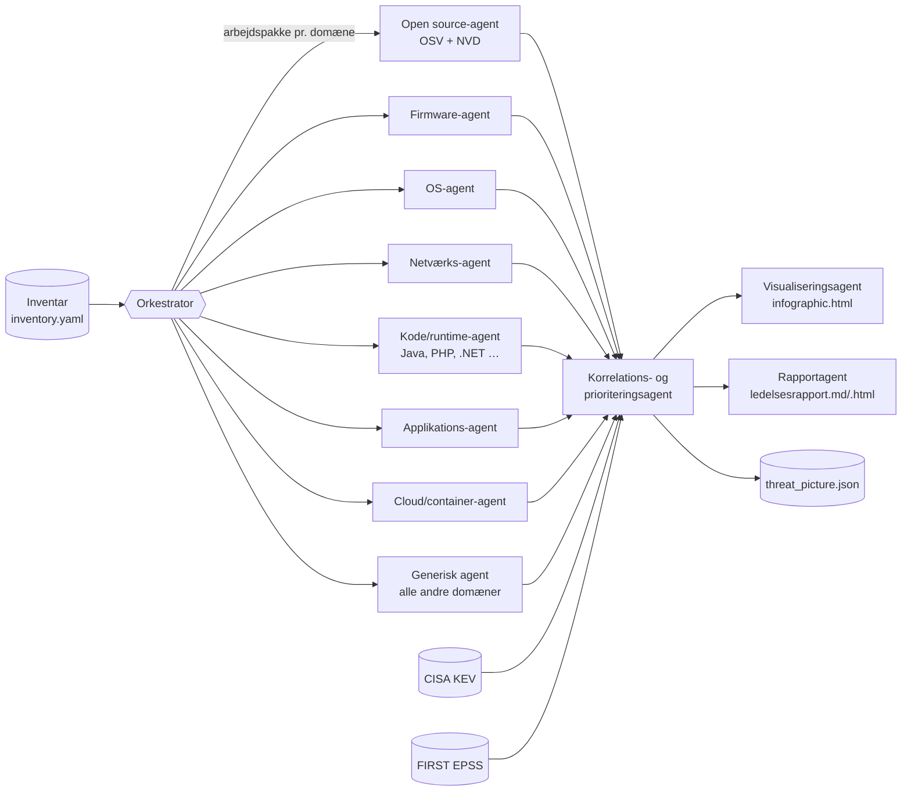

# cve-agents: multi-agent CVE-overblik og ledelsesrapport

En orkestrator fordeler indhentningen af CVE'er ud på domænespecifikke agenter. En korrelationsagent samler fundene, finder afhængigheder mellem dem (angrebskæder) og prioriterer. Til sidst genererer en visualiseringsagent og en rapportagent en infographic og en ledelsesrapport.

## Arkitektur



| Agent | Fil | Ansvar |
|---|---|---|
| Orkestrator | `cve_agents/orchestrator.py` | Opdeler inventaret i arbejdspakker pr. domæne og kører domæneagenterne parallelt. Sender derefter resultatet videre til korrelation og output. |
| Domæneagenter | `cve_agents/agents/domain.py` | Én specialist pr. domæne. Hver agent vælger de feeds, der passer til domænet (NVD med CPE eller nøgleord, OSV for pakke og version), og filtrerer støj fra. Eksempel: Runtime-agenten beholder kun PHP-*runtime*-CVE'er, ikke alle PHP-applikationer. |
| Korrelationsagent | `cve_agents/agents/correlation.py` | Fjerner dubletter og beriger med KEV og EPSS. Klassificerer hvert CVE efter angrebstrin og bygger angrebskæder over forbundne aktiver. Beregner derefter afhængighedsscore, prioritet, tier og indsatser. |
| Visualiseringsagent | `cve_agents/agents/visualization.py` | Laver en selvstændig HTML-infographic med nøgletal, alvorlighed pr. domæne, risikomatrix, angrebskæder, indsatser og top-25. Understøtter lys og mørk tilstand, har tooltips og kan vise data som tabel. |
| Rapportagent | `cve_agents/agents/report.py` | Skriver en dansk ledelsesrapport med resumé, samlet trusselsniveau, prioriterede indsatser med frister og ejere, forklaring af kæderne, overblik pr. domæne, anbefalinger og metode. |
| LLM-tilstand | `cve_agents/llm.py` | Samme arkitektur, men drevet af Claude-agenter via Claude Agent SDK. Se nedenfor. |

### Afhængigheder og angrebskæder

Hvert CVE klassificeres i et eller flere angrebstrin ud fra CVSS-vektor, CWE og beskrivelse:

**Indtrængning** (remote og uautentificeret, eller auth bypass) → **kodeafvikling** → **rettighedseskalering** → **persistens** (firmware/boot).

Kæder findes ved at følge `connects_to`-relationerne i inventaret fra internet-eksponerede aktiver og netværksudstyr. Et eksempel: En RCE i FortiOS på edge-firewallen, en LPE i Windows på domænecontrolleren og en firmwarefejl i iDRAC udgør tilsammen en vej fra internettet til persistent kontrol, selvom hver sårbarhed alene måske kun er "høj".

Hvis inventaret ikke har `connects_to`, bruges standardrelationer mellem domæner: netværk→OS, runtime→OS, OS→firmware osv.

### Scoring

| Mål | Formel |
|---|---|
| Sandsynlighed L | max(EPSS, 0,9 hvis KEV, prior ud fra CVSS-vektor) |
| Individuel risiko (0–10) | CVSS × (0,5 + 0,5·L) × eksponering × kritikalitet |
| Kæde-impact | min(10, højeste CVSS + 0,75 pr. ekstra trin + 0,5 hvis målet er kritisk) |
| Kædescore (0–10) | impact × (0,5 + 0,5·svageste leds L) × eksponering af indgangen |
| Afhængighedsscore | bedste kædescore, CVE'et indgår i |
| Prioritet (0–100) | 10 × max(individuel, afhængighed) + 2 pr. ekstra kæde (højst +6) + 5 ved KEV |
| Tier | P1 ≥ 70 (0–72 t), P2 ≥ 50 (14 dage), P3 ≥ 30 (30 dage), ellers P4. KEV på et internet-eksponeret aktiv giver altid P1. |

Indsatser grupperes pr. aktiv og rangeres efter tier og derefter efter værdi (højeste prioritet + 5 × antal kæder, indsatsen bryder).

## Brug

```bash
pip install -r requirements.txt
python -m cve_agents run -i inventory.example.yaml -o out --days 30
# out/infographic.html, out/ledelsesrapport.md + .html, out/threat_picture.json
```

- `NVD_API_KEY` (valgfri, [gratis](https://nvd.nist.gov/developers/request-an-api-key)): Uden nøgle tillader NVD 5 kald pr. 30 sek. Med nøgle tillader den 50.
- Svar caches i `~/.cache/cve-agents` i 6 timer (`CVE_AGENTS_CACHE`, `CVE_AGENTS_CACHE_TTL`).
- `--workers` styrer, hvor mange domæneagenter der kører parallelt.

### LLM-tilstand (Claude-agenter)

```bash
python -m cve_agents run -i inventory.example.yaml -o out --llm --budget 5
```

Orkestratoren er en Claude-agent med sub-agenterne `cve-<domæne>`, `correlation-analyst` og `reporter`. De deterministiske Python-agenter stilles til rådighed som værktøjer via en in-process MCP-server. Tallene er derfor reproducerbare, mens Claude bidrager med vurdering:

- frasortering af falske positiver (`exclude_false_positive`)
- opslag i leverandørers sikkerhedsbulletiner (WebSearch/WebFetch)
- et skrevet ledelsesresumé

LLM-tilstanden kræver, at Claude Code CLI er logget ind, eller at `ANTHROPIC_API_KEY` er sat.

## Udvidelse med nye domæner

Et domæne uden en specialiseret agent, f.eks. `ot` eller `database`, håndteres automatisk af den generiske agent. Du skal blot angive `domain: ot` i inventaret. Hvis domænet har brug for særlig logik, kan du tilføje en specialist:

```python
from cve_agents.agents.domain import DomainAgent, register

@register
class OTAgent(DomainAgent):
    domain = "ot"
    title = "OT/ICS-agent"
    description = "PLC'er, SCADA og HMI'er."
    relevance = r"plc|scada|hmi|ics|modbus|profinet"
```

## Begrænsninger

- Nøgleordssøgning i NVD giver støj, når navnet er bredt. "WordPress" rammer f.eks. også plugins. Brug CPE, angiv `version`, eller brug `--llm` til at få falske positiver gennemgået.
- Nye CVE'er mangler ofte CVSS, CPE og EPSS de første dage.
- Kæderne viser mulige angrebsveje ud fra inventarets topologi. De er ikke bekræftede kompromitteringer.

## Test

```bash
python -m pytest -q
```
